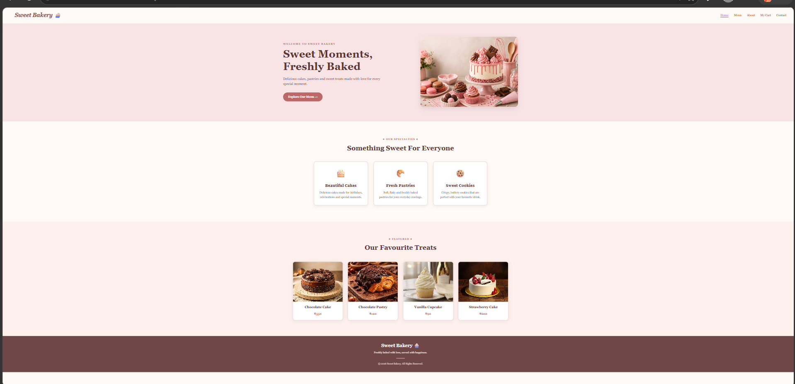
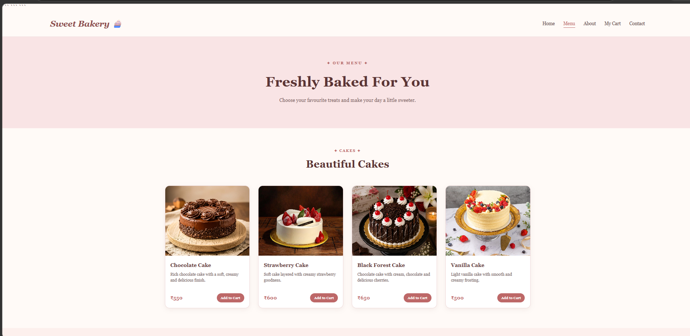
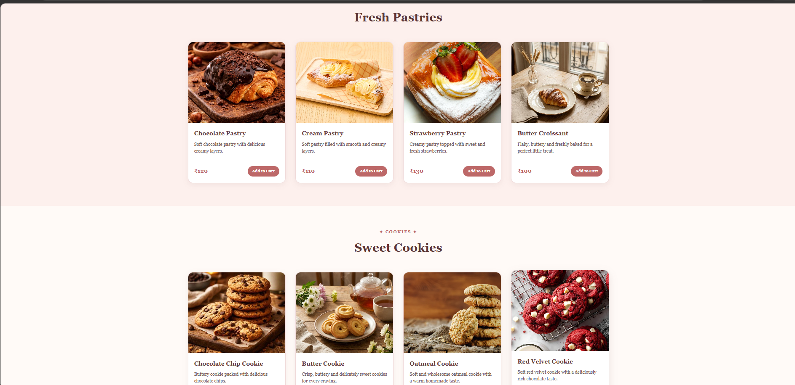
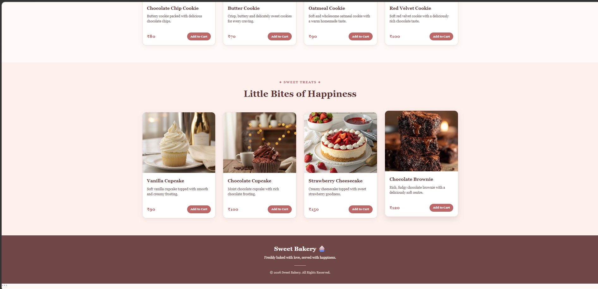
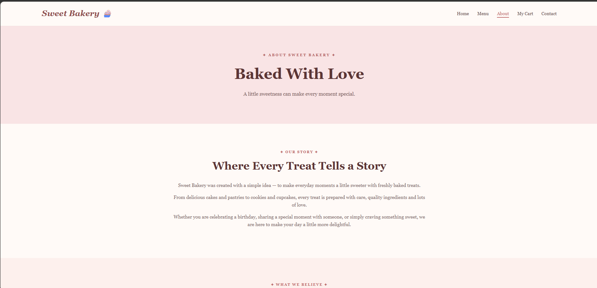
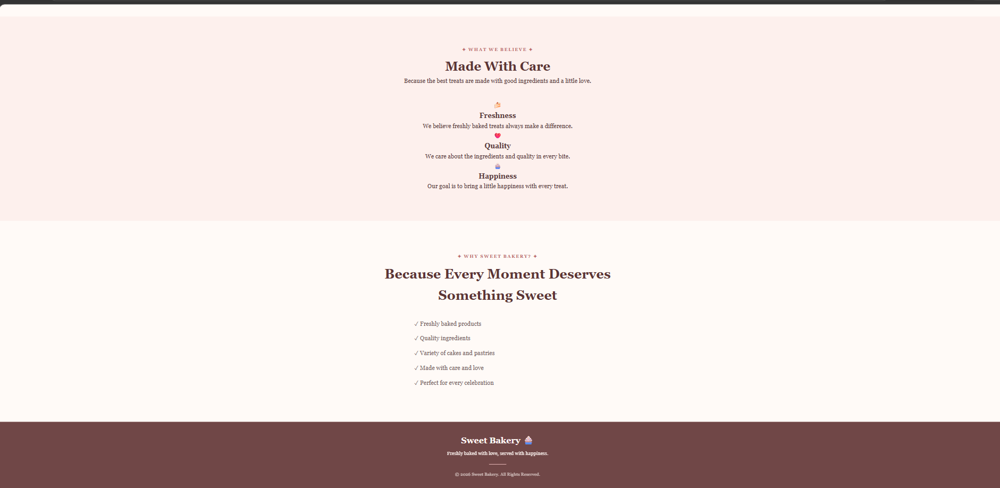
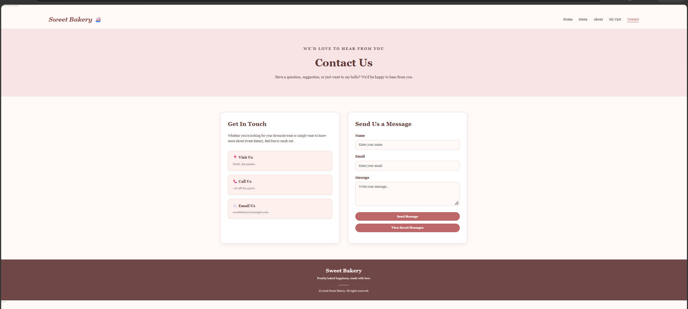
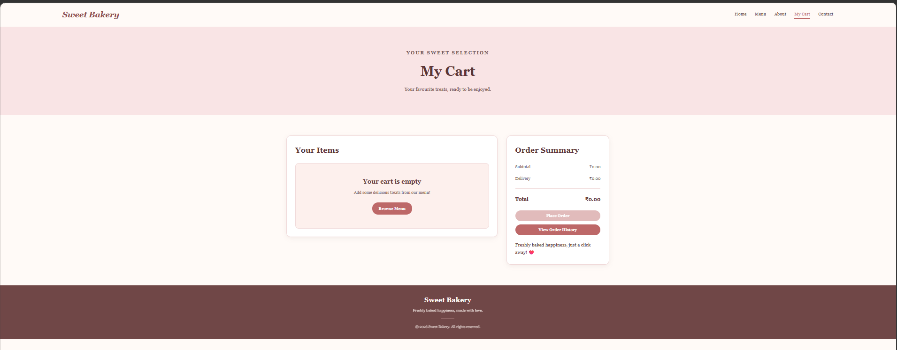

# 🧁 Sweet Bakery

A sweet and welcoming bakery website built using HTML, CSS and JavaScript. Explore delicious cakes, pastries and cookies, browse the menu, and manage your shopping cart.

## ✨ Features

- Beautiful bakery homepage
- Product menu with multiple categories
- About and Contact pages
- Login and Sign Up functionality
- Shopping cart
- Responsive webpage design

## 🛠️ Technologies Used

- HTML5
- CSS3
- JavaScript
- Local Storage
- Session Storage

## 📸 Output Screenshots

### 🏠 Homepage

### 🍰 Menu

### 💗 About Us

### 📩 Contact Us

### 🛒 My Cart

## 🚀 How to Run

1. Clone or download this repository.
2. Open the `04-sweet-bakery` folder.
3. Open `index.html` using VS Code Live Server.
4. Create an account or log in to explore the website.

## 👩‍💻 Developer

**Anjali Ramesh Sangannavar**
